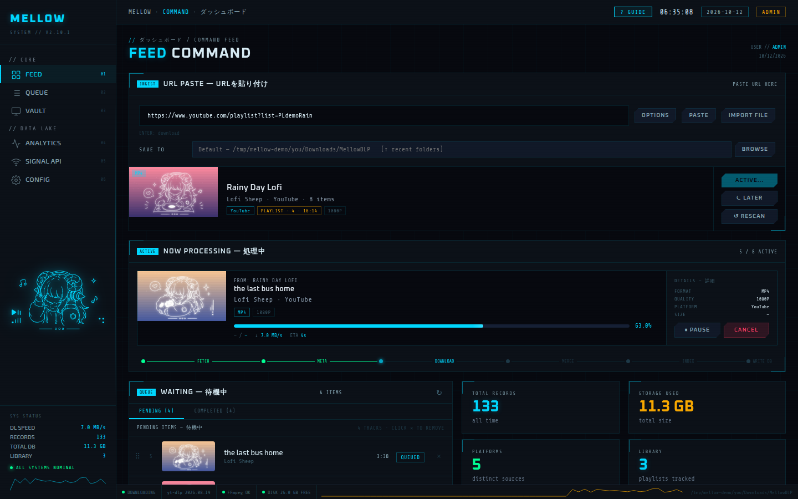
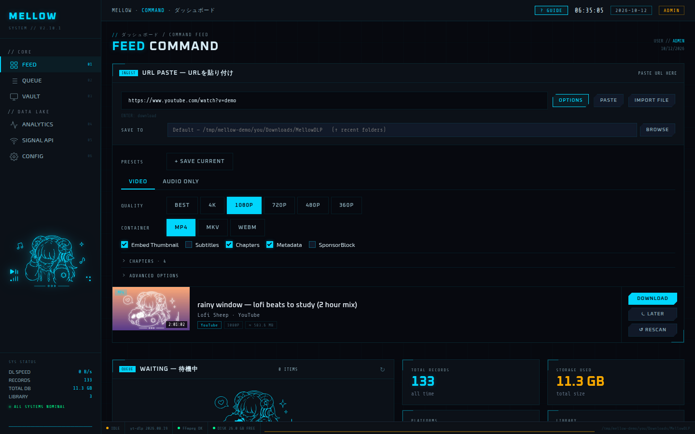
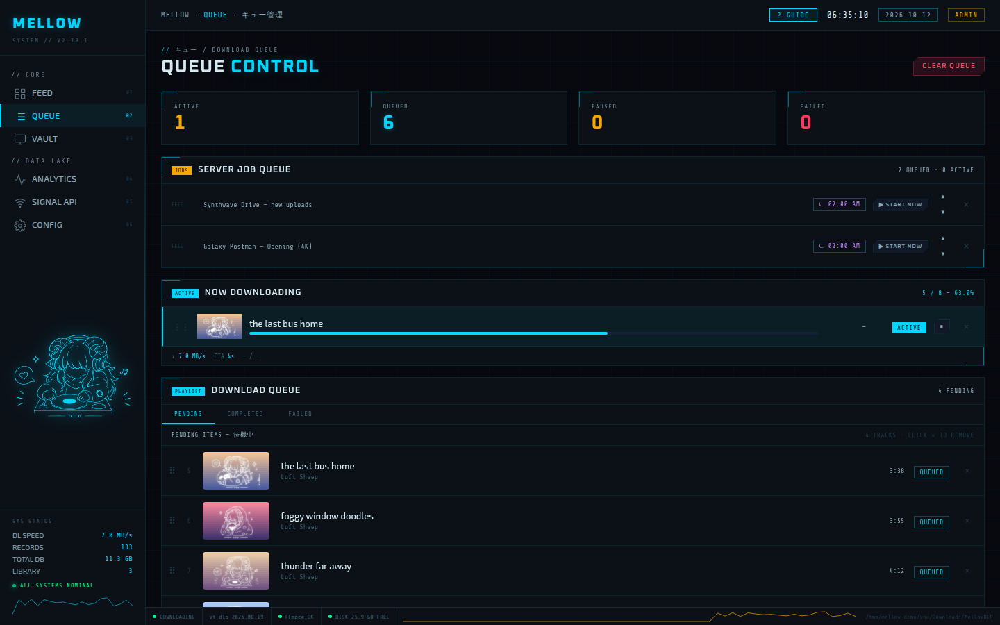
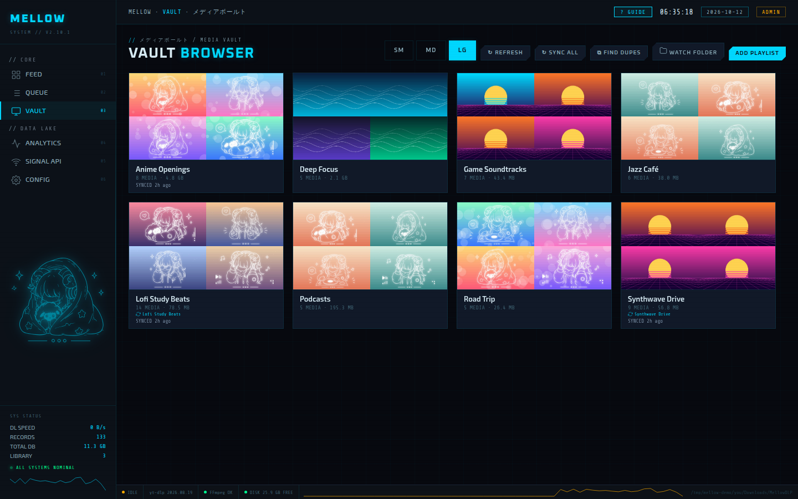
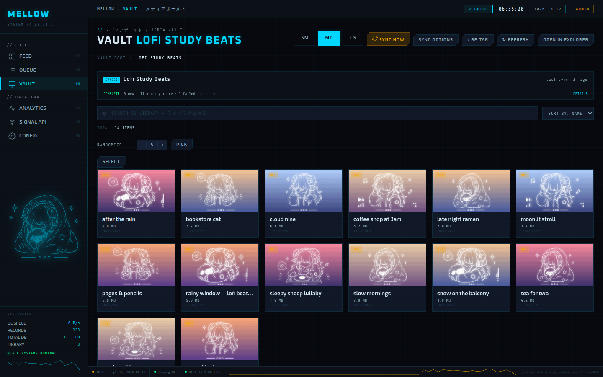
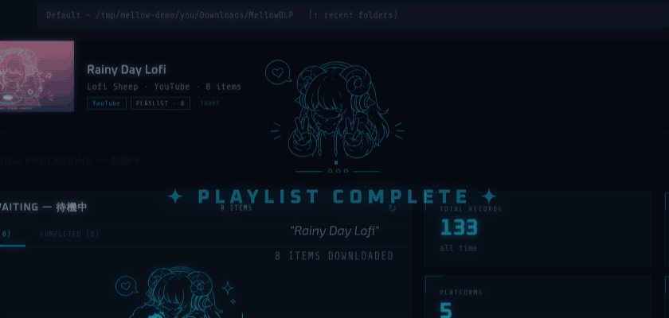
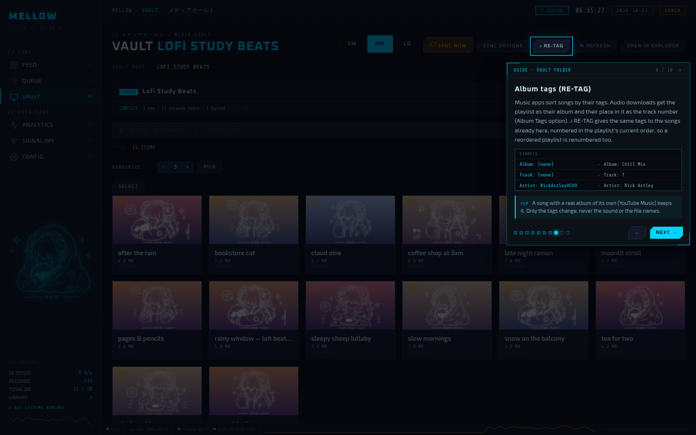
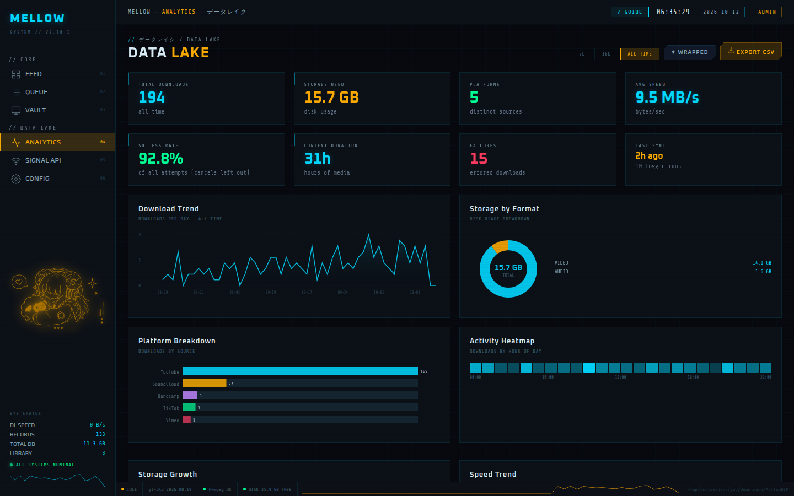

<div align="center">


# MellowDLP

**A cozy desktop app for [yt-dlp](https://github.com/yt-dlp/yt-dlp).**<br>
Paste a link, pick a format, download. Or link a playlist to a folder and let it keep itself up to date.

[](https://github.com/jenox645/Mellow/releases/latest)
[](https://github.com/jenox645/Mellow/releases)
[](https://github.com/jenox645/Mellow/actions/workflows/ci.yml)


**[Download for Windows or Linux](https://github.com/jenox645/Mellow/releases/latest)** · [What's new](CHANGELOG.md) · [Report a bug](https://github.com/jenox645/Mellow/issues/new/choose)



</div>

## Why MellowDLP

<table>
<tr>
<td width="50%" valign="top">

**Downloads without the command line**<br>
Paste a link from YouTube, SoundCloud or [thousands of other sites](https://github.com/yt-dlp/yt-dlp/blob/master/supportedsites.md), or type words to search YouTube. Video up to 4K or audio (MP3, FLAC, Opus…), the size before you start, and every step as it happens.

</td>
<td width="50%" valign="top">

**Playlists that keep themselves in sync**<br>
Link a folder to a playlist or channel: new uploads come in on their own, on a schedule if you like. Nothing downloads twice, and every sync leaves a report of what came in and what failed.

</td>
</tr>
<tr>
<td valign="top">

**A music library, not a pile of files**<br>
Songs arrive with cover art, as one album per playlist, numbered in playlist order, with clean artist names. ♪ RE-TAG does the same for the songs you already have.

</td>
<td valign="top">

**Errors in plain words, with the fix**<br>
"Sign in to confirm you're not a bot", a private playlist, a geo-block, an outdated yt-dlp: each one says what it means and offers a button that fixes it.

</td>
</tr>
<tr>
<td valign="top">

**Looks after itself**<br>
Updates itself and yt-dlp in one click, gets ffmpeg for you, keeps the computer awake while it downloads, and picks up unfinished downloads after a restart.

</td>
<td valign="top">

**Private, and checkable**<br>
No account, no telemetry: your history stays on your computer. Every release is built in public by GitHub Actions and carries a signed provenance you can verify.

</td>
</tr>
</table>

## A look around

**Paste, pick, download.** Video or audio, quality and container, cover art, chapters, subtitles, SponsorBlock, even volume, or just some chapters of a long video. Presets keep your favourite combinations.



**The queue.** Several downloads at once, reordered, paused, or scheduled for the night with ⏾ LATER.



**The vault: your library.** Every download folder with its covers. A folder linked to a playlist syncs with one click or on a schedule.





**Mellow celebrates.** When a playlist or a sync is done, Mellow, the app's mascot, celebrates with you.

<p align="center"></p>

**Not sure what something does?** **? GUIDE** (or the G key) walks you through any page part by part, with made-up examples of what each part shows.



**Your downloads in numbers.** History by platform, format and hour of the day, storage and speed over time, a yearly Wrapped, CSV export, and a SQL console for your own questions.



<sub>Screenshots from made-up demo data (`scripts/screenshots.py`).</sub>

---

## Contents

- [Download](#download)
- [Features](#features)
- [ffmpeg](#ffmpeg)
- [Staying up to date](#staying-up-to-date)
- [Troubleshooting](#troubleshooting)
- [Safety and privacy](#safety-and-privacy)
- [Your files](#your-files)
- [Build it yourself](#build-it-yourself)
- [Thanks](#thanks)

---

## Download

Get the newest release from the [Releases page](https://github.com/jenox645/Mellow/releases/latest):

| File | For |
|---|---|
| `MellowDLP-X.Y.Z-windows-setup.exe` | Windows installer: Start menu entry, uninstaller. **Recommended on Windows** |
| `MellowDLP-X.Y.Z-windows-portable.exe` | Windows, no install: one exe you keep anywhere |
| `MellowDLP-X.Y.Z-x86_64.AppImage` | Linux, any distro: `chmod +x` it and run it |
| `MellowDLP-X.Y.Z-linux-x86_64` | Linux, a plain binary |
| `SHA256SUMS.txt` | Checksums of the files above |

You only download once: every copy updates itself from inside the app ([more](#staying-up-to-date)).

**Windows says "Windows protected your PC"?** The exe isn't code-signed, and SmartScreen warns about unsigned downloads it hasn't seen many times. Click **More info → Run anyway**.

<details>
<summary>Check a download before running it</summary>

Compare its checksum with the one in `SHA256SUMS.txt`:

```
certutil -hashfile MellowDLP-2.10.1-windows-setup.exe SHA256
```

(Linux: `sha256sum -c SHA256SUMS.txt --ignore-missing`.) Or check that it was built from this repository's code by its public release workflow, not uploaded by hand ([GitHub CLI](https://cli.github.com/), from 2.9.0 on):

```
gh attestation verify MellowDLP-2.10.1-windows-setup.exe --repo jenox645/Mellow
```

Updates installed by the app check their checksums themselves and don't trigger the SmartScreen warning.
</details>

The window is a Chrome, Edge, Brave or Chromium app window (Windows always has Edge). A Linux system with none of them opens MellowDLP in your default browser instead.

---

## Features

**Downloading**
- **Feed**: paste a link (or Ctrl+V / drop it anywhere in the window), ANALYZE, pick format and quality, DOWNLOAD. Videos, whole playlists, audio only, or several links at once. Type words instead of a link to **search YouTube**. A link copied while a Mix or playlist plays gets just that video, with one click for the whole list.
- **SAVE TO** under the URL bar: this download's folder. ↑/↓ step through the folders you used before, like a terminal prompt; typing narrows the list. Empty = the default folder from Config.
- **Before you download**: a size estimate (and a warning when it won't fit the drive), and a note when you already have that video, with a shortcut to the file.
- **Options**: embed cover art, metadata, chapters and subtitles; cut out sponsor segments ([SponsorBlock](https://sponsor.ajay.app/)); even out the volume (-14 LUFS); pick chapters or a time range to save only part of a video.
- **Formats**: video as MP4, MKV or WebM at best, 4K, 1080p, 720p, 480p or 360p. Audio as MP3, M4A, AAC or Opus (best, 320, 256, 192 or 128 kbps), FLAC or WAV.

**The queue**
- Live progress per job (speed, ETA, thumbnails). Pause, resume, reorder, cancel; run up to 3 downloads at once (Config → `download_workers`).
- **Download later**: ⏾ LATER queues a download for a set time of day, like the middle of the night (Config → "Later" Downloads Start At; the app must be running).
- **Keeps the computer awake** while downloads run or wait, so a laptop doesn't fall asleep halfway through a playlist (the screen can still turn off; Config → Keep the Computer Awake).
- Unfinished jobs survive a restart; failed items retry with their original options.
- Optional desktop notification and chime when a download finishes or fails in the background.

**Your library**
- **Vault**: browse what you downloaded by folder, with thumbnails, file stats, OPEN and FOLDER buttons.
- **Library sync**: link a folder to a playlist or channel and keep it in step, add-only or mirror (removes files no longer in the playlist). Syncs run on a schedule if you like, and each one leaves a report: what came in, what was skipped, what failed.
- **Music tags**: songs synced as audio carry the playlist as their album and their place in it as the track number, so music apps play the folder as one album, in order. ♪ RE-TAG gives songs already in a folder the same tags.
- **Archive file**: each folder's `mellow_archive.txt` lists what's in it, so nothing downloads twice. Import it on another computer to rebuild the same library.
- **Analytics**: your download history by platform, format and uploader, with CSV export and custom SQL.

**Not sure what something does?** Click **? GUIDE** at the top of any page (or press G): it walks you through that page, part by part.

**When things go wrong**
- **Plain-language errors**: outdated yt-dlp, bot checks, private or removed videos, geo-blocks, network trouble, a full disk… each explained with the fix, often a one-click button.
- **Cookies** from your browser for age-restricted or members-only videos, with a TEST button.
- **Network**: proxy, rate limit, and Force IPv4 for connections where IPv6 hangs.
- **Backup & Restore** (Config): your settings and history as one zip.

---

## ffmpeg

ffmpeg does the merging, converting, trimming and embedding. It isn't bundled, but MellowDLP gets it for you on Windows and Linux: when it's missing, click **GET FFMPEG** (offered at launch, in the status bar and in Config → FFmpeg). It downloads a static build from [BtbN/FFmpeg-Builds](https://github.com/BtbN/FFmpeg-Builds), checks it against the published checksums and keeps `ffmpeg` and `ffprobe` in `~/.mellow_dlp_ffmpeg`. No PATH changes, no restart.

Or install it yourself:

| OS | Command |
|---|---|
| Windows | `winget install Gyan.FFmpeg` |
| macOS | `brew install ffmpeg` |
| Debian/Ubuntu | `sudo apt install ffmpeg` |

MellowDLP looks on `PATH`, next to the app (`ffmpeg/`), in `~/.mellow_dlp_ffmpeg`, and in the usual winget / Chocolatey / Scoop / Homebrew folders, and picks up a fresh install without a restart. For another location, set `"ffmpeg_location"` in `~/.mellow_dlp.json` to the binary or its folder. The status bar shows whether it was found.

Without ffmpeg the app still works, with limits it tells you about: audio stays in its original format (usually `.m4a`), and sites that serve video and audio separately (YouTube) can't be saved as video.

---

## Staying up to date

- **MellowDLP** looks for a new release at launch and every 6 hours, and keeps an **UPDATE** button in the status bar. One click downloads it, checks it against the release's checksums, installs it and restarts; downloads that were running are offered again afterwards. This works for the installer, the portable exe (including one you built with SETUP.bat), the AppImage and the Linux binary. A copy that can't replace itself (say, installed system-wide) says why and links the release page.
- **What's new**: after an update the app shows that release's notes once. Config → WHAT'S NEW lists every release ([CHANGELOG.md](CHANGELOG.md)).
- **yt-dlp** changes as often as the sites do. Config → yt-dlp Version → UPDATE downloads yt-dlp's official release (checksum-verified) and uses it from the next start, in the installed app too.

---

## Troubleshooting

| Problem | Fix |
|---|---|
| `HTTP Error 403`, "Sign in to confirm", "Unable to extract" | yt-dlp is out of date: Config → yt-dlp Version → UPDATE, then restart MellowDLP |
| "ffmpeg missing", audio stays `.m4a` | GET FFMPEG ([above](#ffmpeg)) |
| Age-restricted or members-only videos fail | Config → Browser Cookies: pick the browser you're signed in with, then TEST |
| Downloads hang on some networks | Config → Force IPv4 |
| SmartScreen blocks the exe | [More info → Run anyway](#download) |
| Something else | [Open an issue](https://github.com/jenox645/Mellow/issues/new/choose) with the end of the log: it's `~/.mellow_dlp.log` (`%USERPROFILE%\.mellow_dlp.log` on Windows). Updates log to `~/.mellow_dlp_update.log` |

---

## Safety and privacy

MellowDLP is a personal project, not a company product, so here is what you can check rather than take on trust.

**Where the files come from.** Every release is built and published by [GitHub Actions](.github/workflows/release.yml) from this repository's code, after each build is started and tested. Nobody builds or uploads a file by hand. Each file carries a signed [build provenance attestation](https://docs.github.com/en/actions/security-for-github-actions/using-artifact-attestations/using-artifact-attestations-to-establish-provenance-for-builds) (from 2.9.0 on). With the [GitHub CLI](https://cli.github.com/), `gh attestation verify <file> --repo jenox645/Mellow` shows the commit and the workflow that built it, and fails for any other file.

**Not code-signed (yet).** A Windows code-signing certificate costs money and an identity check, which is why SmartScreen warns. The attestation above is the free way to tie a file to this repository.

**Updates.** The app downloads only from this repository's GitHub releases, only a newer version, and checks the file against the release's `SHA256SUMS.txt` before running anything. yt-dlp updates come from yt-dlp's own releases (checked against its `SHA2-256SUMS`), and GET FFMPEG from [BtbN's builds](https://github.com/BtbN/FFmpeg-Builds) (checked against their `checksums.sha256`). A checksum from the same place as the file catches a broken or swapped download, not a hacked GitHub account; [SECURITY.md](SECURITY.md) has the details and how to report a problem.

**What it connects to.**
- The sites you download from.
- GitHub and PyPI, to look for MellowDLP and yt-dlp updates: at start and every 6 hours while open. Config → **Update Check on Launch** turns both off.
- GitHub, when you click GET FFMPEG or UPDATE.
- [SponsorBlock](https://sponsor.ajay.app/), only when that option is on.
- Webhooks, only those you set up yourself.

There are no accounts and no telemetry: your history and the Analytics page live in a database on your computer. The app's own server listens on `127.0.0.1` only, and refuses requests from web pages.

**What you download is up to you.** Whether you may download something depends on what it is, the site's terms and the law where you live. MellowDLP (like yt-dlp) doesn't get around DRM.

---

## Your files

Everything MellowDLP keeps lives in your home folder (`%USERPROFILE%` on Windows):

| File | What |
|---|---|
| `.mellow_dlp.json` | Settings |
| `.mellow_dlp.duckdb` | Download history, library, sync reports |
| `.mellow_dlp_queue.json` | Unfinished jobs, resumed at the next launch |
| `.mellow_dlp.log`, `.mellow_dlp_update.log` | Logs |
| `.mellow_dlp_ffmpeg/` | ffmpeg from GET FFMPEG |
| `.mellow_dlp_ytdlp.zip` | yt-dlp from UPDATE |

Downloads go to `Downloads/MellowDLP` unless you choose another folder. Uninstalling leaves these files; delete them to start over.

---

## Build it yourself

Windows: run `SETUP.bat`. Linux: `bash setup.sh`. Both need Python 3.12+ and Node.js 20+. [docs/CONTRIBUTING.md](docs/CONTRIBUTING.md) has the details, how to run the tests, how the code is organized, and how a release is made.

---

## Thanks

MellowDLP is a window onto other people's great work: [yt-dlp](https://github.com/yt-dlp/yt-dlp) does the downloading, [FFmpeg](https://ffmpeg.org/) ([BtbN's builds](https://github.com/BtbN/FFmpeg-Builds)) the converting, [SponsorBlock](https://sponsor.ajay.app/) knows where the sponsors are. Built with [Flask](https://flask.palletsprojects.com/), [FlaskWebGUI](https://github.com/ClimenteA/flaskwebgui), [DuckDB](https://duckdb.org/), [mutagen](https://github.com/quodlibet/mutagen), [React](https://react.dev/), [esbuild](https://esbuild.github.io/), [PyInstaller](https://pyinstaller.org/) and [Inno Setup](https://jrsoftware.org/isinfo.php). Fonts: Oxanium, Exo 2 and Share Tech Mono (SIL Open Font License).
